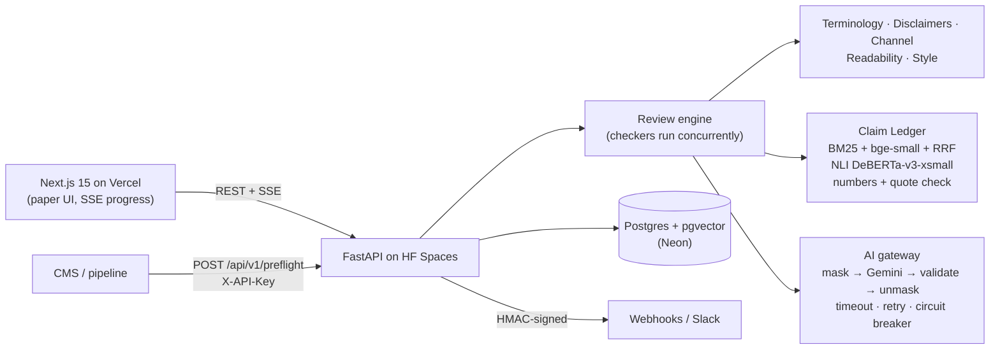

# Preflight

[](https://github.com/Abhijith-Kannan-p/preflight/actions/workflows/ci.yml)

**Content cleared before it goes live.**

**Live demo: https://preflight-eight-smoky.vercel.app** · API: https://kabhijith-preflight-api.hf.space ([OpenAPI docs](https://kabhijith-preflight-api.hf.space/docs))

Content is written by many employees, agencies and AI tools, and off-brand language,
outdated facts and unsupported claims reach the public before the brand owner sees them.
Preflight is a review gate placed before publication. It holds the brand book as versioned
rules, checks every draft against those rules and a registry of approved facts, and returns
cited, explainable findings with suggestions that keep the author's intent. People approve;
the AI never does. Every output traces to a rule or an approved fact, and every decision
traces to a person.

Built solo for CodeAxis Round 2 by team **kabhijith447**. All brand data (PayWise) is fictional.

## Try it in 60 seconds

1. Open the [live demo](https://preflight-eight-smoky.vercel.app) and press **Try the live demo**.
   No sign-up: you are abhi1, a content creator at PayWise. (If the server was asleep you will
   see "Waking up the engine…" for up to a minute.)
2. Pick **LinkedIn post (off-brand)** and press **Run Preflight**. Watch the checkers tick.
3. See the critical **CLM-04** finding ("100% secure", brand_book.pdf p14), the outdated
   settlement time (F-086 superseded by F-087), and the green rows in the **Claim Ledger**.
4. Press **Accept** on the suggestions, then **Re-check**. The Brand Score rises (24 → 97).
5. **Submit for approval**, switch to **abhi4 (Approver)** in the top-right role switcher,
   press **Approve**, then **View Review Receipt**: "Audit chain verified".

Then look around: **Rulebook** (switch to abhi3, Brand Manager, to edit), **Insights**,
**Evaluation** (live precision/recall on 150 labelled claims) and **Settings** (abhi5, Admin:
API keys, webhooks, masking, reset).

| Demo user | Role | Can |
|---|---|---|
| abhi1 | Creator | Submit and revise content, decide on findings |
| abhi2 | Reviewer | Comment, escalate, view insights |
| abhi3 | Brand Manager | Everything a creator can, plus edit rules and facts, approve |
| abhi4 | Approver | Approve or request changes, view insights |
| abhi5 | Admin | API keys, webhooks, AI and privacy settings, demo reset |

## Features

- **Brand Knowledge Base:** versioned rules with source pages, approved facts with validity
  dates and supersession, terminology, channel profiles, confidential terms; CRUD and CSV
  import/export.
- **Multi-format intake:** paste text or Markdown, upload DOCX or PDF; normalised into text
  blocks with exact character offsets for highlighting.
- **Deterministic checks:** product names (case-sensitive, fuzzy near-misses), banned and
  discouraged words, required disclaimers, channel limits, readability, punctuation.
- **Claim Ledger (signature feature):** claims are detected, matched to approved facts by
  hybrid retrieval (dense + BM25 + reciprocal rank fusion), verified by a local NLI model plus
  exact number comparison and a verbatim quote check, and given one of five verdicts. The LLM
  never decides truth.
- **Tone check** against the five-trait PayWise voice profile, with an offline fallback.
- **Explainable findings** (rule, source, evidence, severity, confidence) and
  **intent-preserving suggestions** with a semantic-drift score. Never auto-applied.
- **Workflow:** five roles, a state machine, Accept / Edit / Dispute / Escalate, comments,
  revisions with word diff, critical findings block approval (override needs a written
  reason), notifications, and a **hash-chained audit log** with public verification.
- **Review Receipt** page and PDF. **Brand Score** gauge. **Governance insights.**
- **Integrations:** public REST API with API keys and rate limiting, signed outgoing webhooks
  (Slack format), CSV, DOCX, PDF; `examples/cms_hook.py` shows a CMS pre-publish hook.
- **Privacy and AI transparency:** confidential terms, emails, phones and ₹ amounts masked
  before any LLM call; an "AI used in this review" panel on every review and receipt.
- **Evaluation page** with precision, recall, F1, a confusion matrix and every failure case.
- **Zero-setup demo** with sample drafts, generated history, role switcher and guided tour.

Full checklist mapped to the Round 1 plan: [docs/FEATURES.md](docs/FEATURES.md).

## Architecture



Details, data flow and design decisions: [docs/TECHNICAL.md](docs/TECHNICAL.md).

## Tech stack

Frontend: Next.js 15, React 19, TypeScript, Tailwind, framer-motion, SWR, Recharts, jsdiff.
Backend: Python 3.11, FastAPI, Pydantic v2, SQLAlchemy 2, Alembic, PostgreSQL + pgvector,
fastembed (BAAI/bge-small-en-v1.5), sentence-transformers CrossEncoder
(cross-encoder/nli-deberta-v3-xsmall), rank-bm25, rapidfuzz, textstat, PyMuPDF, python-docx,
reportlab, httpx. LLM: Google Gemini `gemini-3.5-flash-lite` (Groq also supported, or none).
Hosting: Vercel (frontend), Hugging Face Spaces Docker (backend), Neon (Postgres).

## Local setup

```bash
cp .env.example .env          # optional: add LLM_API_KEY; runs fully offline without it
docker compose up --build     # Postgres + pgvector, backend, frontend
```

Frontend http://localhost:3000 · API http://localhost:8000 · docs http://localhost:8000/docs.
The database migrates and seeds itself on first boot. Every variable is documented in
[.env.example](.env.example).

Without Docker: `docker compose up -d db`, then in `backend/` create a virtualenv,
`pip install -r requirements-ml.txt -r requirements-dev.txt`, `alembic upgrade head`,
`python -m app.seed`, `uvicorn app.main:app`; in `frontend/` run `npm ci && npm run dev`.

## API example

```bash
curl -X POST https://kabhijith-preflight-api.hf.space/api/v1/preflight \
  -H "X-API-Key: pf_live_..." -H "Content-Type: application/json" \
  -d '{"content": "PayWise is 100% secure!", "channel": "linkedin"}'
```

Returns the findings, the Claim Ledger, the Brand Score and `blocking: true` when a critical
finding is open. Create a key in **Settings → API keys** (as abhi5).

## Testing and evaluation

- **Backend:** 108 pytest tests (every checker, Claim Ledger verdicts, masking round trip,
  gateway retries and circuit breaker, state machine and permissions, approval gate and
  overrides, audit hash chain including tamper detection, API keys, rate limits, webhook
  signatures, CSV import, receipts, schema validation rejecting fabricated rule and fact IDs).
  `cd backend && pytest`
- **End to end:** Playwright golden path (landing → sample → CLM-04 → accept → re-check →
  submit → approve as abhi4 → receipt with verified audit chain) plus landing, rulebook,
  insights, evaluation and settings tests. `cd e2e && E2E_BASE_URL=... npx playwright test`
- **CI:** ruff, mypy --strict, pytest, eslint, tsc and a production build on every push.
- **Claim Ledger evaluation** (`python -m app.eval.run`, 150 labelled claims, live on the
  Evaluation page): accuracy **0.92**, macro recall **0.90** (target ≥ 0.85), problem-claim
  recall **1.00**, `unsupported` precision **0.86** (target 0.90, not yet met; failure cases
  are listed openly), p50 latency about 125–195 ms per claim on CPU.

## AI and library disclosure

Every model, API, library and dataset is listed in
[docs/AI_AND_LIBRARIES.md](docs/AI_AND_LIBRARIES.md). AI coding assistance (Claude Code) was
used during development; all commits were reviewed and made by the author.

## Documents

[Features](docs/FEATURES.md) · [Technical](docs/TECHNICAL.md) ·
[Changes from the plan](docs/CHANGES_FROM_PLAN.md) ·
[Round 3 improvements](docs/ROUND3_IMPROVEMENTS.md) · [Demo script](docs/DEMO_SCRIPT.md) ·
[User testing](docs/USER_TESTING.md)

## License

MIT
