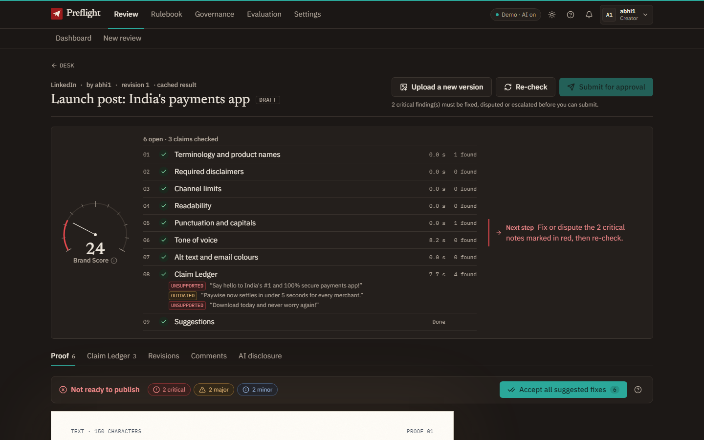
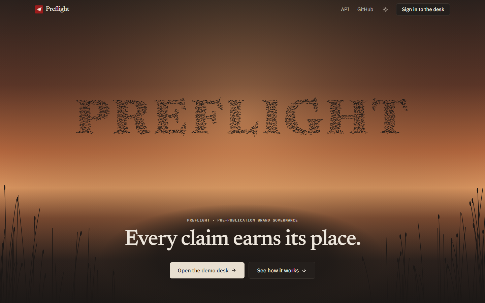
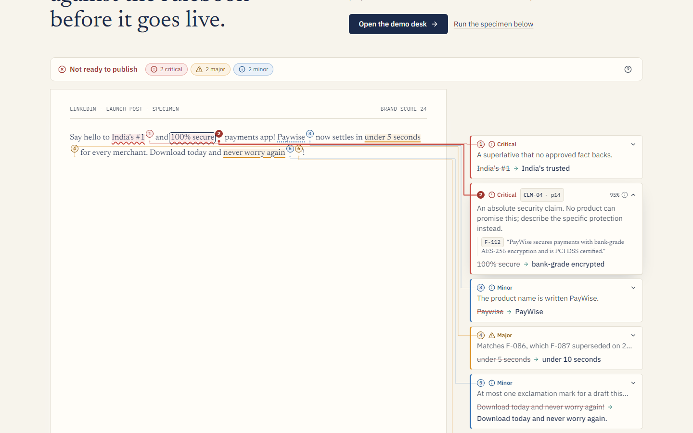
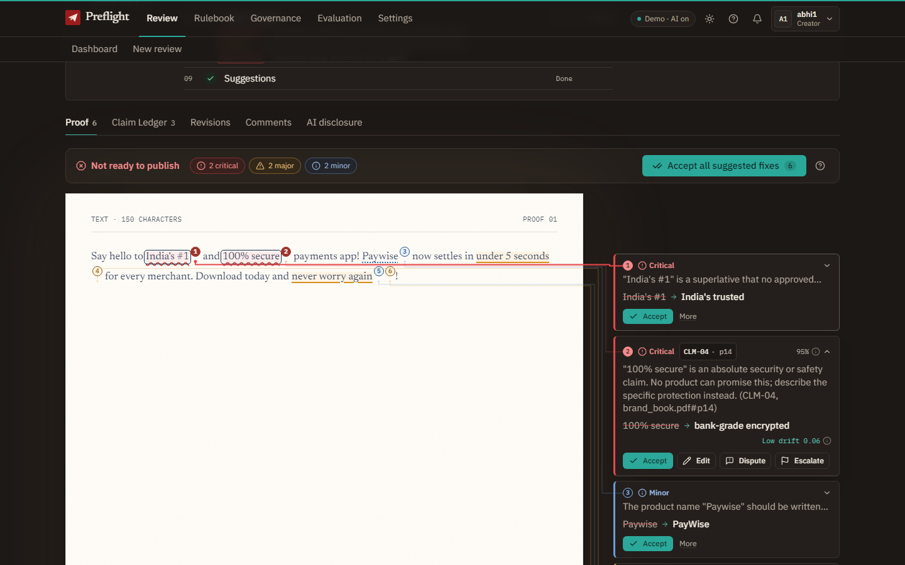
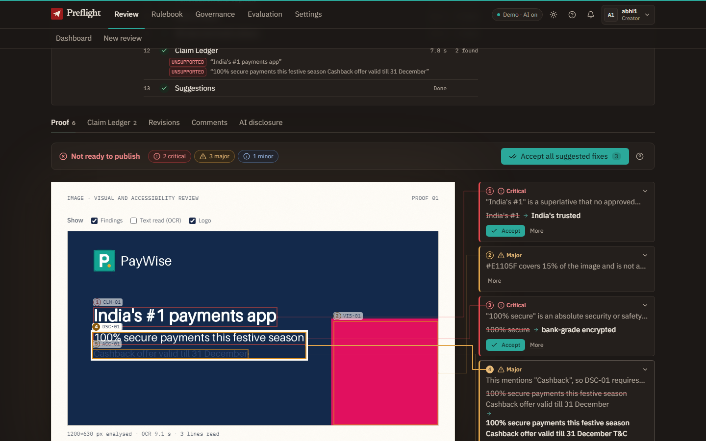
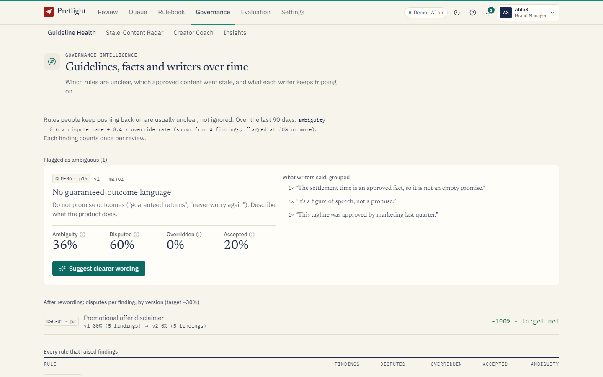
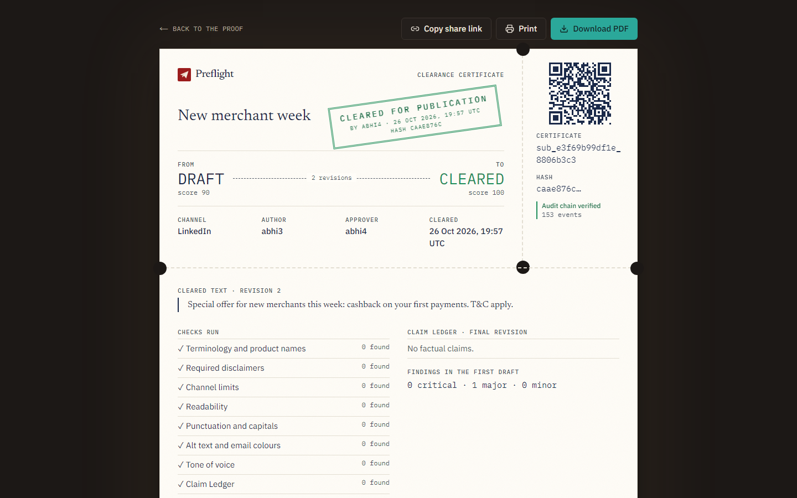
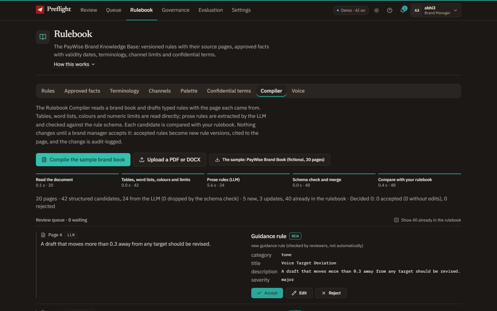
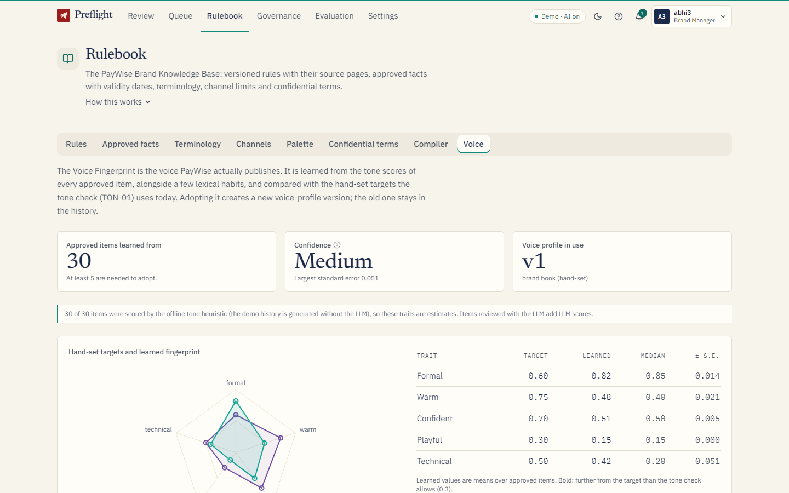
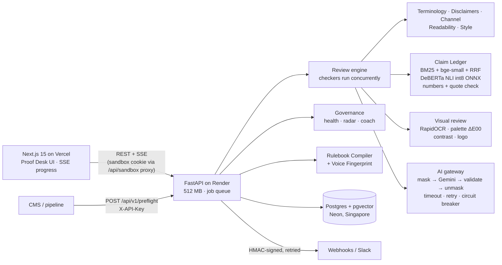

# Preflight

[](https://github.com/Abhijith-Kannan-p/preflight/actions/workflows/ci.yml)

**Content cleared before it goes live.**

**Live demo: https://preflight-eight-smoky.vercel.app** · API: https://preflight-api-nauz.onrender.com ([OpenAPI docs](https://preflight-api-nauz.onrender.com/docs)) · Repository: https://github.com/Abhijith-Kannan-p/preflight

Content is written by many employees, agencies and AI tools, and off-brand language,
outdated facts and unsupported claims reach the public before the brand owner sees them.
Preflight is a review gate placed before publication. It holds the brand book as versioned
rules, checks every draft (text, documents, images and HTML emails) against those rules and a
registry of approved facts, and returns cited, explainable findings with suggestions that
keep the author's intent. People approve; the AI never does.

Built solo for CodeAxis by team **kabhijith447**. **All brand data is fictional: PayWise is
not a real company.**



## Try it in two minutes

Every visitor gets a **private copy** of the PayWise workspace, so nothing you do affects
anyone else. If the free server was asleep you will see "Waking up the engine…" for up to a
minute.

1. Open the [live demo](https://preflight-eight-smoky.vercel.app): a flock of starlings forms
   PREFLIGHT (move the pointer through it and they scatter). Press **Open the demo desk**. You
   are abhi1, a content creator.
2. Pick **LinkedIn post (off-brand)** and press **Run Preflight**. The checklist ticks as each
   checker finishes.
3. Read the margin notes: **CLM-04** "100% secure" (critical, brand book p14), a misspelt
   product name, and an **outdated** settlement time (fact F-086 superseded by F-087).
4. **Accept** the suggestions (or **Accept all suggested fixes**), then **Re-check**: the Brand
   Score goes from 24 to 97. Each mark is numbered and joined by a line to its note, which
   sits level with it.
5. **Submit for approval**, switch to **abhi4 (Approver)** in the top-right role switcher,
   **Approve**, and open the **Clearance Certificate**: "Audit chain verified".

Then try the three Round 3 improvements:

- **Visual review:** New review → **Festive banner (image)**. Text in the image is read and
  checked, off-palette colours, weak contrast and the logo are marked on the image.
- **Governance:** switch to **abhi3 (Brand Manager)** → **Governance**: an ambiguous rule with
  grouped writer complaints and an LLM rewording; **Stale-Content Radar** → "Simulate fact
  update on F-087"; the **Creator Coach**.
- **Brand Autopilot:** as abhi3, **Rulebook → Compiler → Compile the sample brand book**, accept
  rules into the rulebook; **Rulebook → Voice** to adopt the voice learned from approved posts.

| Demo user | Role | Can |
|---|---|---|
| abhi1 | Creator | Submit and revise content, decide on findings |
| abhi2 | Reviewer | Comment, escalate, view insights |
| abhi3 | Brand Manager | Everything a creator can, plus edit rules and facts, compile brand books, adopt the voice, approve |
| abhi4 | Approver | Approve or request changes, view insights |
| abhi5 | Admin | API keys, webhooks, AI and privacy settings, demo reset |

## Screens

Two themes: **Warm Night Desk** (dark, shown first) and **Paper Desk** (light), with teal as the
one accent and red, amber and blue kept for severities. The theme follows the system setting
until you pick one with the sun/moon button in the header; the proof sheet and the certificate
stay a lit paper sheet in both. Every screen below is in `docs/images/` in both
themes (`*-dark.png`, `*-light.png`).

| | |
|---|---|
|  |  |
| **Hero**: thousands of starlings fold, form PREFLIGHT, hold it and scatter; the pointer is a hawk they flee (dusk in dark, paper in light; still with reduced motion) | **Landing**: the specimen proof, every note joined to its mark |
|  |  |
| **Proof sheet**: each numbered mark is joined to its note by an elbow line in its own lane, in the severity colour; the active one is drawn full strength; "Accept all suggested fixes" | **Visual review**: OCR text, palette, contrast and claims as numbered boxes on the image, each joined to its note |
|  |  |
| **Guideline Health**: rules writers push back on, with grouped reasons and the effect of rewording | **Clearance Certificate**: who cleared what, when, against which rules, with a verifiable audit hash |
|  |  |
| **Rulebook Compiler**: rules drafted from a brand book, each beside the sentence it came from | **Voice Fingerprint**: the voice learned from approved content against the hand-set targets |

## Features

Full list with where to find each: [docs/FEATURES.md](docs/FEATURES.md).

**Review engine**
- Paste text or Markdown, or upload DOCX, PDF (including scans), images or HTML emails.
- Deterministic checks: product names (case-sensitive, near-misses), banned and discouraged
  words, required disclaimers, channel limits, readability, punctuation and capitals.
- **Claim Ledger:** claims are matched to approved facts by hybrid retrieval (BM25 + embeddings
  + reciprocal rank fusion), verified by a local NLI model, exact number comparison and a
  verbatim quote check, and given one of five verdicts (supported, outdated, contradicted,
  unsupported, needs a human look). The LLM never decides truth.
- Tone against the PayWise voice; suggestions that keep the author's intent, with a drift
  score; never applied without a person.
- **Visual and accessibility review:** OCR, brand palette (CIEDE2000), WCAG 2.2 contrast, logo
  distortion and clear space, alt text.

**Workflow and trust**
- Five roles, a state machine, Accept / Edit / Dispute / Escalate, revisions with diffs;
  critical findings block approval (an override needs a written reason).
- Hash-chained audit log, Clearance Certificate (page, PDF, QR) and public verification.
- Private demo workspace per visitor, reset that touches only yours, idle copies deleted after
  24 h; double actions are safe (idempotency keys); reviews are server-side jobs that survive a
  refresh; live progress over SSE with reconnect.

**Governance intelligence**
- Guideline Health (ambiguity score, grouped dispute reasons, LLM rewording published as a new
  rule version, before/after per version), Stale-Content Radar (every cleared item indexed by
  the facts it relied on; notifications when a fact changes), Creator Coach.

**Brand Autopilot**
- Rulebook Compiler (brand book in, typed rule candidates with page and sentence out, reviewed
  by a person) and Voice Fingerprint (adopted as a new voice-profile version).

**Integrations and transparency**
- Public REST API with keys and rate limits; signed webhooks for approval, publication and
  critical findings, retried with backoff, with a delivery log and Resend; Slack format.
- Confidential terms, emails, phone numbers and ₹ amounts masked before any LLM call; an
  "AI used in this review" panel on every review and certificate.
- Evaluation page with live numbers for claims, full drafts, visuals and the compiler.

## Architecture



Data flow, the Claim Ledger, the visual pipeline, governance, the compiler, sandboxes,
reliability and the memory budget: [docs/TECHNICAL.md](docs/TECHNICAL.md).

## Run it locally

### With Docker (recommended)

Needs Docker with Compose v2.

```bash
git clone https://github.com/Abhijith-Kannan-p/preflight.git
cd preflight
cp .env.example .env          # optional: add LLM_API_KEY; without it everything runs offline
docker compose up --build
```

Open http://localhost:3000 (API http://localhost:8000, docs http://localhost:8000/docs). The
first start builds both images, downloads the two ONNX models (about 120 MB) and migrates and
seeds the database by itself; the demo history is generated in the background a minute later.
`docker compose down -v` removes everything.

### Without Docker

Needs Python 3.11+, Node 20+ and a Postgres 16 with pgvector (`docker compose up -d db` gives
you one).

```bash
cd backend
python -m venv .venv && source .venv/bin/activate      # Windows: .venv\Scripts\activate
pip install -r requirements-dev.txt
pip install --no-deps -r requirements-ocr.txt          # on Python 3.13 add --ignore-requires-python
python scripts/fetch_models.py
alembic upgrade head && python -m app.seed
uvicorn app.main:app --port 8000

cd ../frontend
npm ci && npm run dev                                  # http://localhost:3000
```

### Environment variables

All are optional locally; `.env.example` has the full list with comments.

| Variable | Default | What it does |
|---|---|---|
| `DATABASE_URL` | local Postgres | Postgres with pgvector (`postgresql+psycopg://…`; Neon needs `?sslmode=require`) |
| `JWT_SECRET` | dev value | Signs demo-user tokens; any long random string in production |
| `LLM_PROVIDER` / `LLM_MODEL` / `LLM_API_KEY` | `none` | `gemini` or `groq`; without a key the product runs fully offline (deterministic mode) |
| `LLM_TIMEOUT_SECONDS` | 8 | Per call; one retry, then the offline fallback |
| `MASKING_ENABLED` | true | Mask confidential data before any LLM call |
| `MODEL_LOADING` | eager | `lazy` loads the models on the first review (small hosts) |
| `NLI_BATCH_SIZE` | 16 | Pairs per NLI pass; 2 on a 512 MB host |
| `EVAL_AT_BOOT` | run | `precomputed` loads the shipped claim evaluation instead of running it |
| `REVIEW_WORKERS` / `REVIEW_TIMEOUT_SECONDS` | 2 / 120 | Review job queue |
| `OCR_THREADS` / `OCR_EXCLUSIVE` | all / false | OCR threads; `true` releases the NLI model while an image is read (512 MB hosts) |
| `CORS_ORIGINS` / `PUBLIC_APP_URL` | localhost:3000 | Frontend origin(s) and the URL used in certificate and webhook links |
| `SANDBOX_COOKIE_SECURE` | true | Secure flag on the demo-workspace cookie |
| `NEXT_PUBLIC_API_URL` | localhost:8000 | Where the frontend calls the API (also the target of its sandbox proxy) |

## API example

```bash
curl -X POST https://preflight-api-nauz.onrender.com/api/v1/preflight \
  -H "X-API-Key: pf_live_..." -H "Content-Type: application/json" \
  -d '{"content": "PayWise is 100% secure!", "channel": "linkedin"}'
```

Returns the findings, the Claim Ledger, the Brand Score and `blocking: true` when a critical
finding is open. Create a key in **Settings → API keys** (as abhi5). `examples/cms_hook.py`
shows a CMS pre-publish hook.

## Testing and evaluation

Full report with every number, the bugs testing found and what remains:
[docs/TESTING.md](docs/TESTING.md).

| What | Result |
|---|---|
| Backend (`cd backend && pytest`) | 210 tests passing; CI runs ruff, mypy, pytest, eslint, tsc and a production build on every push |
| End to end (`cd e2e && npx playwright test`; `E2E_BASE_URL` / `E2E_API_URL` for production) | J1–J6 journeys plus page and accessibility specs: 17/17 locally; every journey passed against production |
| Accessibility | axe on 12 pages at 375, 768 and 1440 px: no violations; Lighthouse accessibility 100 on every page, locally and in production |
| Load | Five visitors reviewing at once all complete (34–114 s in production on one worker) |
| Memory (512 MB, 0.1 CPU) | Container peak 385 MiB; server process peak 445 MiB for any review, 474 MiB with five visitors at once (includes ~96 MiB of shared libraries) |
| Claim Ledger (`python -m app.eval.run`) | 150 labelled claims: accuracy 0.96, problem-claim recall 1.00, `unsupported` precision 0.94; on 27 held-out claims written afterwards: 0.67 |
| Full drafts (`python -m app.eval.drafts`) | 20 labelled drafts: precision 0.92, recall 0.89, 15/20 exactly right, 7/7 clean drafts pass |
| Visual review (`python -m app.eval.visual`) | 100 labelled assets: precision 1.00, recall 0.99, OCR words read 98.3% |
| Rulebook Compiler (`python -m app.eval.compiler`) | 51 labelled rules: recall 94%, precision 100%, 100% acceptable without edits (with Gemini) |

## Deployment

- **Frontend:** Vercel, root `frontend/`, `NEXT_PUBLIC_API_URL` set to the API URL. A rewrite
  sends `/api/sandbox/*` to the API so the demo-workspace cookie is first-party.
- **Backend:** Render free plan from `render.yaml` (Singapore, 512 MB, 0.1 CPU). Models are
  downloaded at build time; migrations and seeding run on start (`backend/start.sh`).
  Secrets set in the dashboard: `DATABASE_URL`, `JWT_SECRET`, `LLM_API_KEY`.
- **Database:** Neon Postgres with pgvector, in the same region as the API (a different
  region made every query cost about 0.4 s).
- **Keep-warm:** `.github/workflows/keep-warm.yml` pings `/health` on a 10-minute schedule;
  GitHub runs scheduled workflows late on the free tier, so a cold start is still possible.
- `bash deploy/render-sim.sh` reproduces the free plan's limits in Docker and reports time and
  memory per stage.

## Limitations

- Demo sign-in is a role switcher with signed tokens, not real accounts.
- On Render's 0.1 CPU an off-brand text review takes about 28 s and a visual review 22–44 s;
  deterministic findings appear first. Five reviews at once are handled one after another.
- The Claim Ledger's Round 3 rules were tuned on the 150-claim set; on held-out claims
  `unsupported` precision is 0.67 and one claim was wrongly judged supported.
- The visual evaluation set and the sample brand book were made by us; real photographs and
  real brand books will score lower.
- Gemini's free tier rate-limits under heavy use; tone and wording then use offline fallbacks.
- Checks, models and evaluations are built for English; Hindi text is accepted and reviewed,
  but its claims and tone are not checked reliably.
- Webhook URLs are not checked against private network addresses.

More in [docs/FEATURES.md](docs/FEATURES.md#known-limitations) and
[docs/TESTING.md](docs/TESTING.md#known-remaining-issues).

## Documents

[Features](docs/FEATURES.md) · [Technical](docs/TECHNICAL.md) ·
[Round 3 improvements](docs/ROUND3_IMPROVEMENTS.md) · [Testing](docs/TESTING.md) ·
[Roadmap](docs/ROADMAP.md) · [Changes from the plan](docs/CHANGES_FROM_PLAN.md) ·
[AI and libraries](docs/AI_AND_LIBRARIES.md) · [Demo script](docs/DEMO_SCRIPT.md) ·
[User testing](docs/USER_TESTING.md)

## AI and library disclosure

Every model, API, library and dataset is listed in
[docs/AI_AND_LIBRARIES.md](docs/AI_AND_LIBRARIES.md). AI coding assistance (Claude Code) was
used during development; every commit was reviewed and made by the author.

## License

MIT, see [LICENSE](LICENSE).
